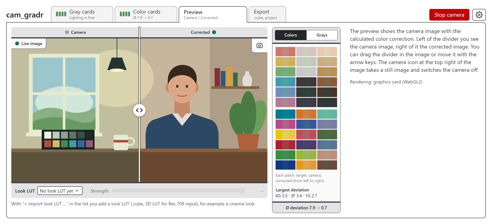

# cam_gradr

**Correct the colors of your webcam with the Datacolor Spyder Checkr Photo.** Hold the cards in front of
the camera: the app helps you set the light, measures the colors and calculates a 3D LUT that corrects
them. You download the LUT as a `.cube` file for a camera monitor or video software.

**Open the app: <https://avalax.github.io/cam_gradr/>**

Everything runs in your browser. Images and measurements never leave your computer.

## What you need

- a webcam and the **Datacolor Spyder Checkr Photo** (two gray cards and two color cards with 48 patches)
- a current Chrome, Edge or Firefox
- even light on the cards, without reflections and shadows

## How it works

1. **Prepare the camera.** Lock auto exposure and auto white balance in the camera's own software; the
   app cannot do that, and automatic adjustments falsify the measurement. Choose the camera and the
   resolution in the settings behind the gear icon (1280 × 720 is a good start) and switch the camera
   on at the top right.
2. **Gray cards: set the light.** Hold both gray cards steady where the subject will be. The app finds
   them, takes a still image and switches the camera off. A dot in the measuring field next to the image
   shows brightness (vertical) and contrast (horizontal). Change the light or the camera and start the
   camera again until the dot sits in the framed window in the middle; hover the field for details.
3. **Color cards: calculate the correction.** Without changing the light or the camera, hold both color
   cards in the same place. The correction is calculated by itself. A divider compares the camera
   colors with the corrected ones, and the label below gives the mean deviation before and after (hover
   it for each patch).
4. **Preview: check the result.** The camera image on the left and the corrected image on the right
   of a divider that you drag or move with the arrow keys; with the camera off it shows the still image
   of the color cards. The side column shows each colored patch as target, camera and corrected and
   names the largest deviations; switched to the grays it shows the gray ramp and how shadows, midtones
   and highlights change. The camera icon at the top right of the image takes a still image to check the
   correction on a steady image; in the card tabs the same corner holds the trash icon.
   Below the image you can lay a **look LUT** over the correction, a ready-made `.cube` file such as a
   cinema look: the last entry of the list imports one (several at once are fine), and the slider sets
   its strength. The arrow keys switch the look at once, also with the list open, and Escape goes back
   to the one before. The trash icon next to the list deletes the chosen look LUT. With a look LUT, a
   click on the label above the image switches its side: the left one between camera and corrected, the
   right one between the look over the correction and the look alone on the camera image.
5. **Export: download the LUT.** Choose 17³, 33³ or 65³ and download the `.cube` file. Larger LUTs are
   more accurate, but some devices only accept 17³ or 33³ (see their manual). With a look LUT chosen in
   the preview, the file holds correction and look at the set strength; "Correction only" leaves the look
   out. The file name and the first lines of the file name the look and its strength.

You can switch between the tabs at any time. Below each name is a short result with four bars: green
means good (light in the normal range, or a mean deviation of at most 2 after the correction), yellow
means check the hint.

**Corner points:** You can drag them on the still image. The trash icon in the corner of the image
deletes them and starts a new search. Starting the camera searches again too; if it stops without a new
still image, the old one comes back. Cards held upside down are recognized.

**Projects:** In the Export tab, "Save project" and "Load project" keep your work as a JSON file, with
the still images if "Include still images" stays checked. Saving suggests the file you loaded last. The
file holds only the name of the reference set, not its values. As soon as a look LUT is imported,
"Include look LUTs" (checked by default) puts all imported look LUTs into the file, with the chosen one,
its strength, the preview sides and the export choice. Loading such a project restores exactly that
list, also in another browser; loading a project without look LUTs starts without any and removes the
imported ones from the browser. Project files from versions before 2.0 can no longer be loaded.

## Tips

- Hold the cards steady, completely in the image and parallel to the camera. Blurred shots are not
  recognized.
- Light both cards evenly. Light from the side and reflections falsify the colors.
- The brightest gray patches must not burn out and the darkest must not sink into black. Fix the
  brightness first, then the contrast.
- After the gray cards, change neither the light nor the camera settings.
- The dark appearance (settings → Appearance) throws less light from the screen onto the cards.

## Questions

**The camera does not start.** Allow camera access in the browser and close other programs that use the
camera.

**The cards are not recognized.** Hold them completely in the image, steady and well lit. The app takes
the still image as soon as it finds the cards twice in a row in the same place.

**The deviation stays high.** Usually the shot is the cause: burnt-out or black patches, uneven light or
camera automatics. Read the hints in the result and capture the cards again.

**Can I change the language?** The app follows your browser (English or German). You can change it in
settings → Language.

**Which version do I have?** The line at the bottom of the page names it, and so does the first line of
every `.cube` file. A preview of a pull request adds its number.

**Which look LUTs fit?** 3D LUTs in the `.cube` format (up to 129³) made for Rec.709 input, like the
"look" or "creative" LUTs of most LUT packs. Conversion LUTs from the log curve of a camera (S-Log, LogC,
V-Log …) belong in front of a look on such a camera; on a webcam the correction of cam_gradr does that
job, and such a LUT makes the shadows too dark and the contrast too hard. The app warns about them by
their name.

**Where does my data go?** Nowhere. Imported reference sets and look LUTs stay in your browser. A project
file with still images contains camera images, one with look LUTs contains the LUT files; only pass it on
if that is fine (bought LUTs usually must not be shared).

## Reference values

The app ships the Lab values of the 48 color patches. They are **not from Datacolor**, who does not
publish them in machine-readable form, but an unofficial transcription from the blog post
[Patch color definitions for Datacolor SpyderCheckr 48](https://www.bartneck.de/2017/10/24/patch-color-definitions-for-datacolor-spydercheckr-48/)
(bartneck.de), with the typos the post mentions corrected. Whether they match your card exactly (batch,
aging) is not proven.

In settings → Reference values you switch the set, import your own file or download the active set. A file
holds Lab values (white point D50) per patch ID `1A` to `6H` (digit = row, letter = column; card 1 =
columns A–D, card 2 = E–H), at least 12 patches with at least 4 neutral ones (columns D and E):

- **JSON:** `{ "format": "cam_gradr-reference/1", "name": "My set", "illuminant": "D50",
"patches": [{ "id": "1A", "lab": [L, a, b] }, …] }`
- **CSV:** columns `id; L; a; b` (separated by semicolon, tab or comma, optional header line; with
  semicolons also a decimal comma)

## Known limits

- The correction (a tone curve per channel, a 3×3 matrix and a fine adjustment per hue) only partly
  makes up for a webcam that distorts colors strongly. A good shot matters more.
- The LUT works in sRGB / Rec.709, the color space of webcams and HDMI video. The cyan 1F and the yellow
  3F lie outside it; the app measures them against the nearest color sRGB can show.
- The correction never cuts colors off. Where it would push the most saturated colors out of sRGB or
  bright tones above white, it compresses them in proportion, so colors right at the edge of sRGB come
  out slightly less saturated than the reference.
- The LUT is calculated from the image as the browser decodes it. If the device that applies the LUT
  decodes the signal differently (BT.601 instead of BT.709, limited instead of full range), the LUT does
  not fit exactly; check the result there.
- The patch positions are measured on one SCK300 card with three webcams; other batches are not
  verified.
- Without WebGL2 the preview uses a slower, downscaled rendering.

## License

[MIT](LICENSE) for the source code. The bundled reference set comes from an unofficial third-party source
and is not covered by it.
